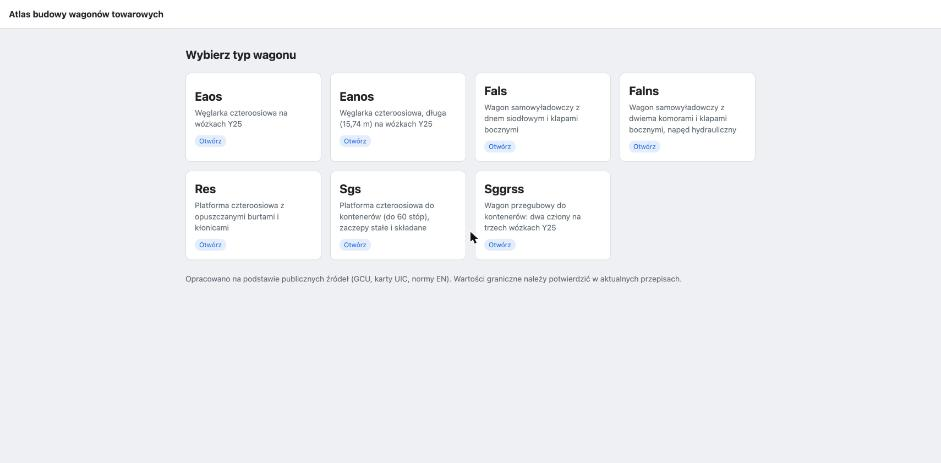
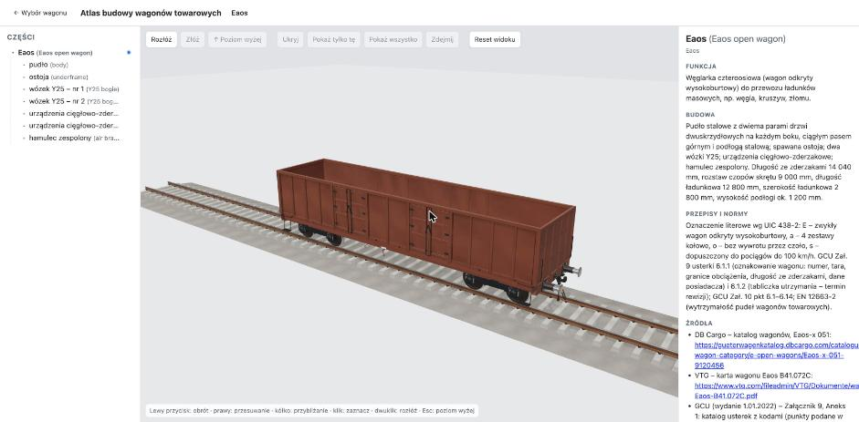
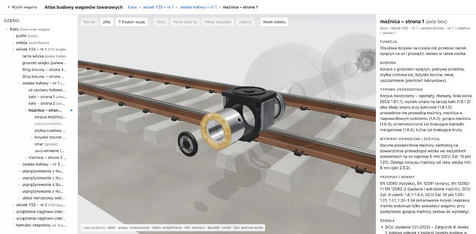

# Atlas budowy wagonów towarowych

Interaktywna strona do nauki i sprawdzania budowy wagonów towarowych (węglarki, wagony samowyładowcze, platformy). Wybierasz typ wagonu, a potem klikasz jego części w widoku 3D i rozkładasz je coraz głębiej, aż do pojedynczych elementów, np. wagon › wózek Y25 › zestaw kołowy › maźnica › łożysko. Przy każdej części jest opis: do czego służy, z czego się składa, typowe uszkodzenia, wymiary graniczne i przepisy.

Strona jest przeznaczona dla pracowników biurowych serwisu naprawy wagonów – na komputer z myszką (Chrome lub Edge), działa też na telefonie (iPhone, Android, pionowo i poziomo).

**Strona:** https://mateusz-hub1.github.io/wagony/







## Wagony

| Seria | Rodzaj |
|---|---|
| Eaos | węglarka czteroosiowa na wózkach Y25 |
| Eanos | węglarka czteroosiowa, długa (15,74 m) |
| Fals | wagon samowyładowczy z dnem siodłowym i klapami bocznymi |
| Falns | wagon samowyładowczy z dwiema komorami i klapami bocznymi, napęd hydrauliczny |
| Res | platforma z opuszczanymi burtami i kłonicami |
| Sgs | platforma do kontenerów (do 60 stóp), zaczepy stałe i składane |
| Sggrss | wagon przegubowy do kontenerów: dwa człony na trzech wózkach Y25 |

Wspólne podzespoły (wózek Y25, urządzenia cięgłowo-zderzakowe, hamulec zespolony, przegub, układ wyładunku) są zbudowane raz i użyte we wszystkich wagonach.

## Funkcje

- obrót, przybliżanie i przesuwanie widoku myszką,
- podświetlanie części po najechaniu, kliknięcie otwiera panel opisu,
- rozkładanie (dwuklik albo przycisk „Rozłóż”) z płynną animacją – poziom po poziomie,
- ścieżka nawigacji (np. Eaos › Wózek Y25 › Zestaw kołowy › Maźnica) z cofaniem,
- drzewo części w bocznym panelu, zsynchronizowane z widokiem 3D,
- ukrywanie części i „Pokaż tylko tę”,
- zdejmowanie elementów (np. pokrywy maźnicy, sworznia przegubu) i otwieranie klap,
- na telefonie: widok 3D na cały ekran, drzewo części w menu ☰, opis w karcie wysuwanej od dołu, przycisk „‹ Wstecz”; jeden palec obraca, dwa palce przybliżają i przesuwają, dotknięcie zaznacza, podwójne dotknięcie rozkłada.

## Uruchomienie lokalne

Strona nie wymaga instalacji ani budowania. W katalogu projektu:

```
python3 -m http.server 8000
```

i w przeglądarce: http://localhost:8000

## Budowa projektu

- `index.html`, `src/main.js` – strona i start aplikacji (Three.js ładowany z CDN),
- `src/engine/` – silnik widoku 3D (wczytywanie danych, nawigacja, rozkładanie),
- `src/components/` – wspólne podzespoły 3D, `src/wagons/` – poszczególne wagony,
- `data/` – opisy części w plikach JSON (drzewo części z polem `children`); `data/components/` – opisy wspólnych podzespołów.

Treść opisów jest oddzielona od kodu 3D, więc opisy można poprawiać bez zmian w kodzie.

## Źródła

Opracowano na podstawie publicznych źródeł (GCU, karty UIC, normy EN). Wartości graniczne należy potwierdzić w aktualnych przepisach. Źródła każdej części są podane w jej opisie. Wymiary, których nie udało się potwierdzić w źródłach, są w modelu szacunkowe.

---

© 2026 Mateusz. Wszelkie prawa zastrzeżone.
